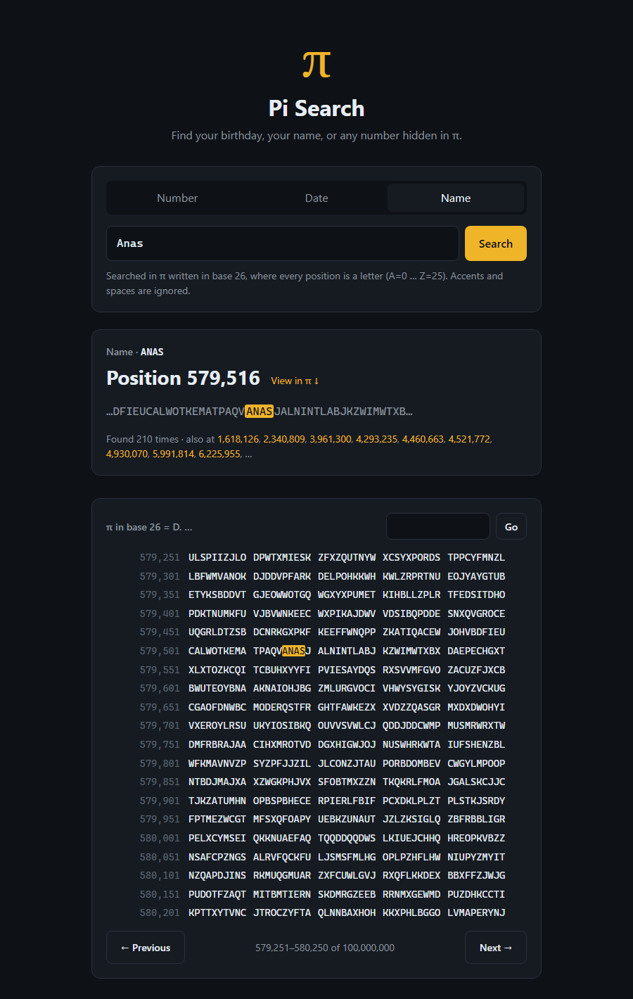
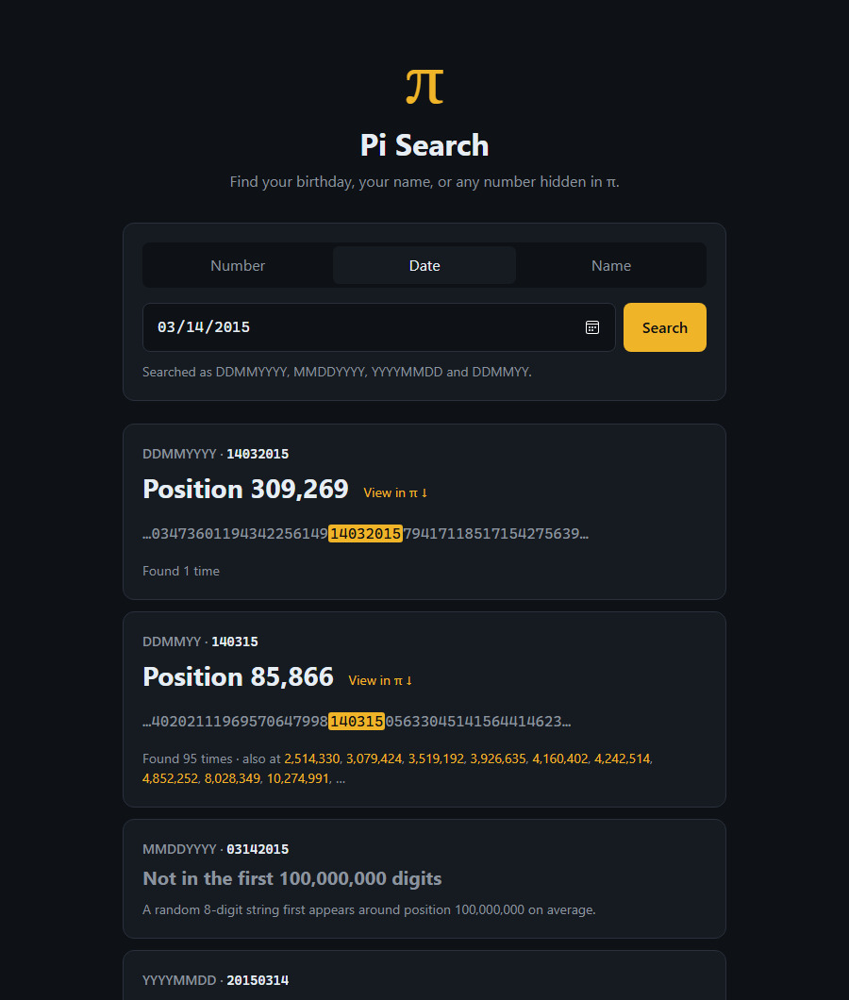

# π Pi Search Engine

**Find your birthday, your name, or any number hidden in the first 100 million digits of π.**

<p align="center">
  
</p>

## Features

- **Number search**: any digit sequence. `999999` (the famous *Feynman point*) is at position **762**.
- **Date search**: tries four formats at once: `DDMMYYYY`, `MMDDYYYY`, `YYYYMMDD`, `DDMMYY`.
- **Name search**: searches π written in **base 26**, where every position is a letter (A=0 … Z=25).
  In base 26, π starts `D.DRSQLOL…`, so it laughs at you in the first 8 letters.
- **Digit viewer**: browse π page by page, jump to any position, click a result to see it highlighted.
- **Every match is counted**, overlapping ones included, along with where it shows up next.
- **Shareable links**: every search updates the URL, so you can send someone straight to their result.
- **Not found? You get the math**: a random *k*-symbol string first shows up around position *base^k*.

<p align="center">
  
</p>

## Quick start

Requires Python 3.10+.

```bash
git clone https://github.com/anasaadi02/pi-search-engine.git
cd pi-search-engine
pip install -r requirements.txt

python make_digits.py 10 100000000   # pi.txt         (~6 min)
python make_digits.py 26 100000000   # pi_base26.txt  (~10 min)

python server.py                     # open http://127.0.0.1:8000
```

The data files aren't in the repo because they're 100 MB each. Want to try it fast? Generate `1000000` digits instead; it takes seconds.

## How it works

### 1. Computing π in any base (`make_digits.py`)
Floats only hold about 16 digits, so π is computed with **gmpy2** (Python bindings for GMP/MPFR, the C libraries behind serious math software).
To get *n* digits in base *b*, shift the point and floor:

```
frac(π) × bⁿ  →  floor  →  one big integer whose base-b digits are π's digits
```

The same idea in base 10: `0.14159 × 10³ = 141.59 → 141`. A few extra *guard digits* make sure rounding never touches the digits we keep.
Leading zeros vanish in an integer, so they're padded back on.

### 2. Searching (`search.py`)
The digits sit in memory as one string, and Python's `str.find` (C code using a Boyer–Moore–Horspool variant) scans 100 MB in milliseconds.
After each hit the search moves forward **one** position, not the length of the match, because matches can overlap: `11` appears **3** times in `1111`.

### 3. Why base 26 for names?
Mapping letters to digit pairs (A=01 … Z=26) wastes 74 of the 100 possible pairs, so names get buried.
In base 26 every symbol is a letter, so each one is equally likely:

| Name length | Pairs (A=01…Z=26) | Base 26 |
|---|---|---|
| 4 letters | ~100,000,000 | **~457,000** |
| 5 letters | ~10,000,000,000 | **~11,900,000** |
| 6 letters | ~10¹² | **~309,000,000** |

### 4. Server & UI (`server.py`, `index.html`)
- **Server:** Python's standard library only. Data is loaded once at startup, there are just three routes (`/`, `/api/search`, `/api/digits`), and every input is validated and clamped.
- **Interface:** a single HTML file with no framework and no build step. Native date picker, `textContent` instead of `innerHTML` (no HTML injection), and a request counter so slow, stale responses can't overwrite new ones.

## Project structure

```
make_digits.py   compute π in base 10 or 26
search.py        search, encoders, self-tests (run: python search.py)
server.py        HTTP server + JSON API
index.html       the whole frontend
docs/            screenshots
```

## Is every pattern really in π?

Probably, but **nobody has proven it**. That would require π to be a *normal number*, which is still an open problem.
Every statistical test so far says π behaves as if it were normal, and this project is a fun way to watch that happen.
